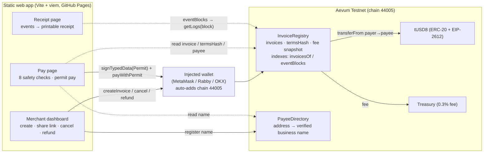
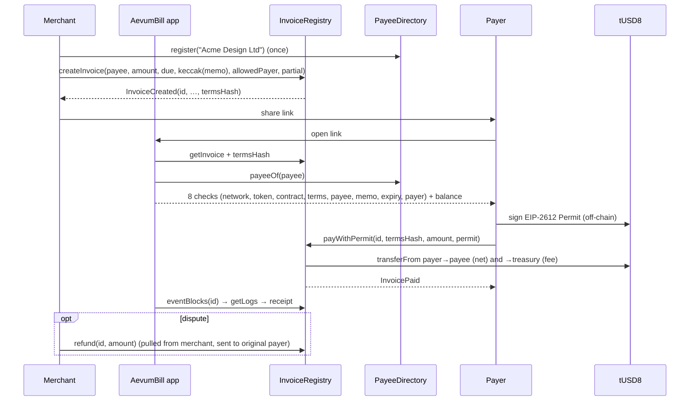

# AevumBill: invoices your client can't pay wrong

**On-chain invoices settled in tUSD8 on Aevum Testnet.** A merchant issues an invoice whose amount, payee, due date, memo and (optionally) the only allowed payer are locked on-chain. The payer opens a link, sees eight safety checks including a **verified payee name**, and pays exactly once with a single EIP-2612 permit signature + one transaction. The receipt is rebuilt straight from chain events.

Built for **Aevum Builder Challenge #1 (QDay × DoraHacks), Invoice Payments track**. All code in this repo was written during the build window (from 2026-11-16).

| | |
|---|---|
| Live demo | https://solivansprvill-droid.github.io/aevum-bill/ |
| Network | Aevum Testnet · chain id `44005` · RPC `https://rpc-test.qday.info` · explorer https://explorer-test.qday.info |
| Settlement token | tUSD8 (6 decimals, EIP-2612 permit, domain `tUSD8` / version `2`) [`0x4565…3483`](https://explorer-test.qday.info/address/0x456569838f1d43009A91ebA4263147Afd7233483) |
| Contracts | see [Deployments](#deployments) |
| Licence | MIT |

---

## 1. Problem

Paying an invoice in stablecoins today means copying an address and an amount into a wallet by hand. That leads to familiar failures:

* **Invoice-redirection fraud.** A scammer edits a PDF or email and swaps in their own address. Nothing tells the payer the address isn't the supplier's.
* **Wrong amount / double payment.** Fat-finger amounts, a second click, or paying an invoice that was already cancelled. A plain token transfer can't be undone, so the merchant has to refund by hand.
* **Paying the wrong invoice.** With several open invoices to the same supplier, transfers aren't tied to any invoice, so reconciliation is guesswork.
* **No proof.** Both sides end up rebuilding "what was paid for what" from wallet history.

## 2. Solution

AevumBill moves the invoice itself on-chain and makes the contract enforce the rules a careful accounts-payable clerk would:

| Rule | Enforced by |
|---|---|
| Pay only the exact amount (or partial, never above the total, if the merchant enables it) | `WrongAmount`, `Overpayment` |
| Pay once | status machine `Open → Paid` (`InvoiceNotOpen`) |
| No payment after cancel or after the due date | `InvoiceNotOpen`, `InvoiceExpired` |
| Pay the invoice you reviewed, not a swapped one | payer passes the `termsHash` they saw (`TermsMismatch`) |
| Only the named client may pay (optional) | `allowedPayer` (`PayerNotAllowed`) |
| Fee can't change after issue; fee ≤ 1% | fee snapshot per invoice, `MAX_FEE_BPS = 100` |
| Refunds go only to the original payer, never more than paid | `refund()` (`RefundTooLarge`) |
| Confirmation of payee | `PayeeDirectory`: a unique business name written only by the receiving key |
| Emergency brake | owner `setPaused` blocks new invoices and payments; cancels and refunds keep working |

The registry is **non-custodial**: tokens move payer → payee (+0.3% → treasury) inside the pay transaction, and the contract never holds a balance.

## 3. Architecture



* **No backend.** Everything is read from the public RPC. Aevum's RPC caps `eth_getLogs` at 1,000 blocks, so the registry keeps a tiny on-chain index (`invoicesOf(merchant)`, `invoicesPaidBy(payer)`, `eventBlocks(id)`) and the receipt page queries logs only at those exact blocks.
* **The memo stays off-chain.** Only `keccak256(memo)` is stored. The memo text travels in the share link, and the pay page re-hashes it, so an edited link fails the *memo integrity* check.
* **Share link** = `#/pay/<id>?t=<termsHash prefix>&memo=<text>`. If any on-chain term differs from what the merchant shared, the *link matches on-chain terms* check fails and the Pay button is disabled.

### Contracts

| Contract | Purpose | Key functions |
|---|---|---|
| `InvoiceRegistry.sol` | invoice lifecycle and settlement | `createInvoice`, `pay`, `payWithPermit`, `cancel`, `refund`, `termsHash`, `getInvoice`, `invoicesOf`, `eventBlocks`, admin `setFee`/`setTreasury`/`setPaused`, 2-step ownership |
| `PayeeDirectory.sol` | confirmation of payee | `register(name, website)`, `remove`, `payeeOf`, `nameKey` (case-insensitive uniqueness, charset `[A-Za-z0-9 .&'-]`, 3-40 chars) |

Events: `InvoiceCreated`, `InvoicePaid(id, payer, payee, amount, fee, totalPaid, fullyPaid)`, `InvoiceCancelled`, `InvoiceRefunded`, `FeeUpdated`, `TreasuryUpdated`, `PausedSet`, `PayeeRegistered`.

## 4. Workflows



1. **Merchant onboarding:** connect wallet (chain 44005 is added automatically), register a business name once.
2. **Issue:** fill payee / amount / due date / memo / optional allowed payer / partial toggle, then copy the pay link.
3. **Pay:** the payer opens the link, reviews the checks and pays. Permit is tried first; if the wallet can't sign typed data the app falls back to `approve` + `pay`.
4. **Receipt:** `#/receipt/<id>` shows status, amounts, fee, payer, terms hash and a timeline with explorer links. Print or save it as a PDF.
5. **After-sales:** the merchant can cancel an unpaid invoice, or refund part or all of a paid one from the dashboard.

## 5. Deployments

<!-- DEPLOYMENTS:START -->
Status: **contracts compiled, tested and dry-run on an Aevum fork; the public testnet deployment is waiting on faucet funds for the deployer.** See `deployments/aevum-testnet.json` and the e2e log `deployments/e2e-aevum-testnet.json` once live.

| Item | Value |
|---|---|
| Deployer (testnet-only throwaway) | `0x09e8D2E7802F7Ec7F186D4440075c6aE358dCd54` |
| InvoiceRegistry | _pending_ |
| PayeeDirectory | _pending_ |

Fork dry-run (anvil fork of Aevum Testnet against the **real tUSD8 contract and its permit**): `deployments/e2e-local-fork.json`. register → create → 3 blocked attacks (`WrongAmount`, `TermsMismatch`, `PayerNotAllowed`) → `payWithPermit` → double pay blocked (`InvoiceNotOpen`) → receipt (paid 0.5 tUSD8, fee 0.0015).
<!-- DEPLOYMENTS:END -->

## 6. Tests

`forge test`: **26 tests pass**, including 7 fuzz properties at 1,000 runs each (see [`docs/test-results.txt`](docs/test-results.txt)).

* value conservation: payer debit = payee credit + fee, fee ≤ 1%, registry balance always 0
* only the exact amount is accepted; partial payments never overpay
* any forged `termsHash` is rejected
* refunds are bounded by what was paid
* directory rejects names outside the allowed charset

Coverage: InvoiceRegistry 95% lines / 88% statements; total 92% lines.

## 7. Run it

```bash
# contracts
cd contracts
git submodule update --init   # forge-std
forge test -vv

# web app
cd ../web && npm install && npm run dev      # http://localhost:5173
npm run build                                 # → ../dist (static, relative paths, GitHub Pages ready)

# deploy your own (TESTNET ONLY)
cp .deployer.secret.example .deployer.secret  # fill a throwaway key, chmod 600
bash scripts/go-live.sh                       # deploy → verify → e2e → rebuild
```

Get test funds at https://faucet.qday.info/en (5 tQDAY + tUSD8 per 24h).

## 8. Tech

Solidity 0.8.24 (no external contract deps, hand-rolled safe transfer and reentrancy guard), Foundry (forge/anvil/cast), Vite 5 + TypeScript + viem 2 (no framework, about 100 kB gzipped), GitHub Pages. EIP-2612 permit, EIP-3085 `wallet_addEthereumChain`.

## 9. Security notes and limits

* Testnet prototype, not audited.
* The fee treasury and owner are the deployer key in this demo. In production use a multisig.
* A payee name is self-asserted (it proves *this key* claims the name, not legal identity). The roadmap below adds attestations from a KYB provider.
* Partial-payment invoices lock to the first payer so refunds have one clear destination.

## 10. Roadmap

Recurring invoices and subscriptions · multi-token invoices · KYB attestations for payee names · CSV / accounting export · email/webhook notifications via an indexer · post-quantum signer support as Aevum rolls it out.
